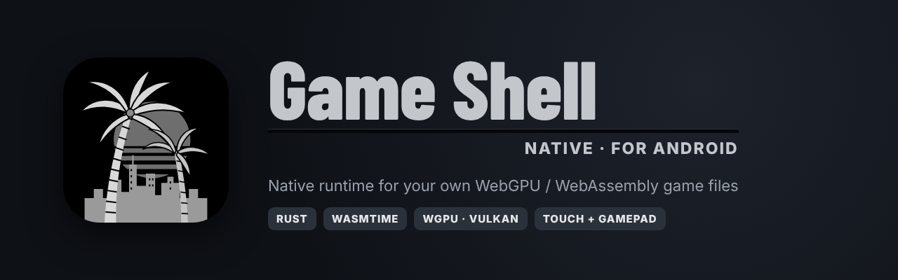

<p align="center">
  
</p>

<p align="center">
  <a href="../../releases/latest"></a>
  <a href="../../actions/workflows/android.yml"></a>
  
  
  
</p>

<p align="center">
  <b>A native Android runtime for heavy WebGPU / WebAssembly games.</b><br>
  No browser, no WebView: the game runs on Wasmtime + wgpu (Vulkan) with a launcher, Winlator-style touch controls and full gamepad support.<br>
  <sub>Bring your own files: the app contains no game data and downloads nothing.</sub>
</p>

---

## Contents
- [Why](#why)
- [Features](#features)
- [Requirements](#requirements)
- [Install](#install)
- [Your game files](#your-game-files)
- [First run](#first-run)
- [Controls](#controls)
- [Performance](#performance)
- [Troubleshooting](#troubleshooting)
- [Build from source](#build-from-source)
- [Project layout](#project-layout)
- [Credits and license](#credits-and-license)

## Why
Running a 16 GB WebGPU game in mobile Chrome works, but the browser costs heat, memory and frames.
Game Shell Native runs the same WebAssembly build **natively**: Wasmtime executes the code, wgpu drives Vulkan
directly, and a small Android launcher handles setup, settings and controls. The APK is about 22 MB; the game stays
in its own folder on your phone and is read in place (no second copy).

## Features

| | |
|---|---|
| 🚀 **Native runtime** | Rust · Wasmtime · wgpu on Vulkan. Game runs in its own process for clean restarts. |
| 📁 **Find the game anywhere** | Android folder picker or **Scan phone**. Detects the game by its files, so folder names don't matter. |
| ⚙️ **Presets and fine-tuning** | Performance / Balanced / Quality presets, chosen automatically for your chip and RAM; render scale, FPS cap, textures, fixed resolution. |
| 🎮 **Touch controls** | Winlator `.icp` layouts: buttons, D-pad, sticks, trackpad, radial menus, range keys, toggles, icons. Import your own. |
| ✏️ **Layout editor** | Built like Winlator's: floating toolbox, grid snap, per-element bindings (keyboard / mouse / gamepad), scale, opacity, autosave. |
| 🕹️ **Gamepad** | USB and Bluetooth controllers, full button remap, deadzone and look-speed sliders. |
| ⌨️ **Keyboard** | On-screen keyboard that types into the game, plus hardware keyboards. |
| 🧊 **Freeze watchdog** | If the picture stops while sound plays, a banner offers a one-tap restart and saves a report. |
| 🌡️ **Heat and HUD** | Overheating warning, FPS counter or detailed HUD with FPS graph. |
| 💾 **Safety nets** | Automatic save backups after each session, layout backups, file verification against the pinned build, log export. |
| 🎨 **Launcher design** | Bold two-pane home, bundled fonts and vector icons, accent colours, haptics, scales to any screen size. |

## Requirements
- **Android 9 or newer, 64-bit ARM (arm64-v8a)** with **Vulkan 1.1**.
- **8 GB RAM or more** recommended. Snapdragon 8 Gen 2 / Gen 3 class chips (Adreno 740/750) run it best.
- About **17 GB of free storage** for the game folder.
- "All files access" permission, so the app can read the game folder where it is.

## Install
1. Open **[Releases](../../releases/latest)** and download `GameShellNative.apk`.
2. Open it on your phone and allow "Install unknown apps" for your browser or file manager when asked.
3. Updates install straight over the previous version: every release is signed with the same key.

> Coming from a build before v0.5.3 (debug-signed)? Uninstall the old app once first. Your saves and layouts are
> backed up in `Documents/GTA5NativeData` and are restored automatically.

## Your game files
The app does not include, download or link to any game files. You can download the complete sample/testing,
browser build 8b0b5899ed of the game as 14 parts from
https://github.com/alihammoud21/playgta5/releases/tag/full-game-v1.
Download every playgta5-part-*-of-14.zip, extract all of them into the same folder, and the game is ready to play. Once extracted, the folder looks like this:

```
<any folder name>/
├── data/
│   └── manifest.json
├── b/
│   └── 8b0b5899ed/
│       └── game.wasm
└── shaders/
    └── index.json
```

- Put it anywhere: internal storage, Download, an SD card. The name of the folder does not matter.
- The app recognises it by these files, even several levels deep.
- **Settings → Quick check** compares every file's size with the pinned build, and **Full verify** checks every SHA-256
  hash. Both write a list of bad or missing files to `Downloads/GameShell-verify.txt`.
- If a different build is found, the app warns you before playing.

## First run
1. **Welcome:** a quick overview.
2. **File access:** allow "All files access".
3. **Find your game:** tap **Choose folder** or **Scan phone**.
4. **Tune it:** pick a preset (the recommended one is marked) and a touch layout.
5. Press **PLAY**. The first launch compiles the game for your GPU and takes several minutes; later launches reuse the cache.

## Controls
- **Touch:** pick a layout per game (FPS, Virtual Gamepad, GTA 5 (Winlator), RTS, Template or your own).
  Open **Controls** on the home screen to use, edit, copy, create or import `.icp` layouts.
- **Editor:** drag the toolbox anywhere. Tap an element to select it, drag to move (it snaps to the grid), and open
  the element sheet to set type, shape, bindings, size, opacity, toggle, icon and text. Every change saves automatically.
- **Gamepad:** works as soon as it's connected. Remap buttons in **Settings → Gamepad**.
- **In game:** the **Back** gesture or the ☰ button opens the side menu: resume, restart, exit, HUD, switch layout live,
  keyboard, mute, graphics, clear cache.

See [docs/CONTROLS.md](docs/CONTROLS.md) for the full binding list.

## Performance
| Preset | Render scale | FPS cap | Textures | For |
|---|---|---|---|---|
| Performance | 40 % | 30 | Low | Older or hot phones |
| Balanced | 50 % | 30 | Low | Most phones |
| Quality | 65 % | 30 | Medium | Snapdragon 8 Gen 2 / Gen 3 |

Every value can be changed per game (render scale up to 100 %, 60 FPS or no cap, High textures, fixed resolution).
Tips: unplug the charger while playing to keep the phone cooler, close background apps, and drop one preset if the heat warning appears.

## Troubleshooting
| Problem | Fix |
|---|---|
| Black screen after playing twice | Fixed in v0.5.1: every Play now starts a fresh game process. Update. |
| Picture freezes, sound keeps going | Tap **Restart** on the freeze banner. Reports are saved in `Documents/GTA5NativeData/reports`. |
| Crash or blank screen after an update | **Settings → Clear graphics and temp data**, then Play (the shader cache rebuilds). |
| "Game not found" | **Scan phone**, or **Choose folder** and pick the folder that holds `data/` and `b/`. |
| Stutter or heat | Lower the preset, or set a 30 FPS cap. |
| Anything else | **Settings → Export log to Downloads** and open an [issue](../../issues/new/choose) with `GameShell-runtime.log`. |

## Build from source
Every push to `main` builds the APK on GitHub Actions; every `v*` tag also publishes a signed **Release**.
To build locally (Linux or macOS, JDK 17, Android SDK + NDK 28.2, Rust 1.98.1):

```sh
rustup target add aarch64-linux-android
sdkmanager "platforms;android-35" "build-tools;35.0.0" "ndk;28.2.13676358"
./make-android.sh            # debug APK  -> build/GameShellNative-debug.apk
./make-android.sh release    # unsigned   -> build/GameShellNative-unsigned.apk
```

Details, signing and the release flow: [docs/BUILDING.md](docs/BUILDING.md).

## Project layout
```
src/                Rust runtime: Wasmtime host, wgpu renderer, audio, input, file system, JNI bridge
android/app/        Android launcher (Java): home, wizard, settings, controls editor, in-game overlay
  assets/profiles/  bundled .icp touch layouts
  assets/fonts/     Barlow Condensed + Inter (OFL)
vendor/wgpu-core/   patched wgpu-core
docs/               building, installing, controls
.github/workflows/  CI: build, sign, release
```

## Credits and license
- **Runtime:** [GTAV Mobile](https://github.com/alihammoud21/gtav-mobile) by alihammoud21, based on
  [Muguet](https://github.com/c22dev/muguet) by Constantin Clerc (c22dev), with upstream contributors.
- **Controls:** the `.icp` format, control icons, the GTA 5 layout and the editor design come from
  [Winlator](https://github.com/brunodev85/winlator) by brunodev85 (LGPL-2.1).
- **Fonts:** Barlow Condensed and Inter (SIL OFL 1.1). **Icons:** Material Icons by Google (Apache 2.0).
- **App icon and launcher design:** original work for this project.

Game Shell Native is free software under the **GNU GPL v3 or later** ([LICENSE](LICENSE)). All notices and the list of
changes are in [NOTICE.md](NOTICE.md), and every version is listed in [CHANGELOG.md](CHANGELOG.md).

> **Disclaimer.** This project is not affiliated with or endorsed by Rockstar Games or Take-Two Interactive. Grand
> Theft Auto and related marks belong to their owners. The repository and the app contain no game code or assets,
> and you are responsible for having the right to use any game files you load. This is a private, non-commercial project.

<p align="center"><sub>Made by <b>beworkall</b> · Ayyaz</sub></p>
